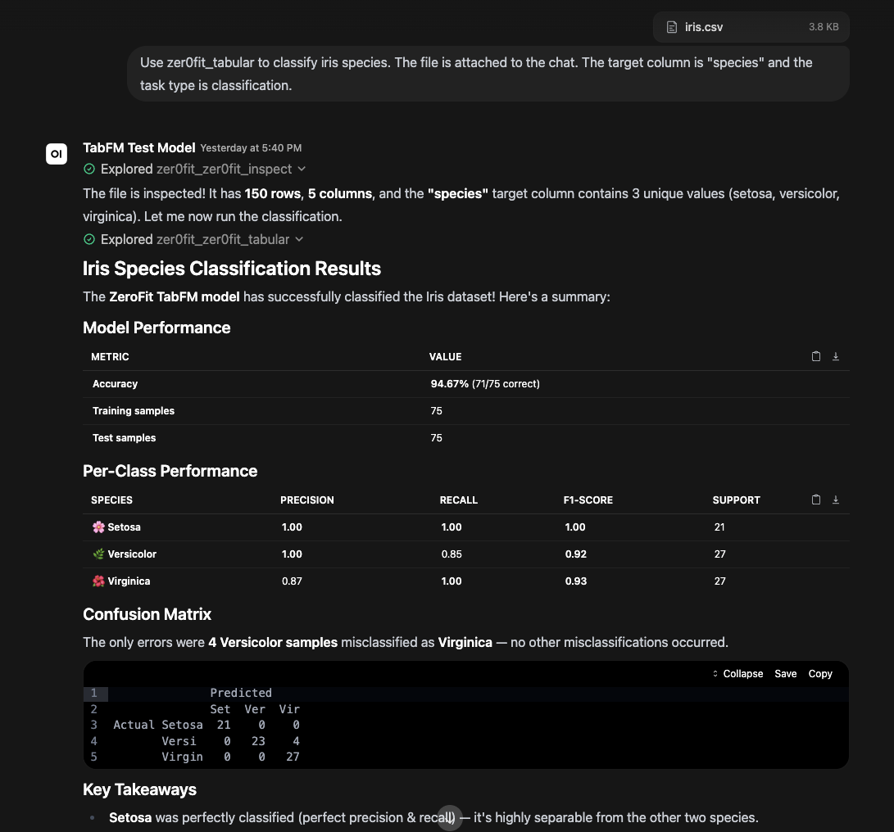

# Zer0Fit — Zero-Shot Forecasting & Tabular MCP Server

<p align="center">
  
</p>

Zer0Fit exposes Google's **TimesFM 3.0** (time-series forecasting) and **TabFM v1.0.0** (tabular classification/regression) foundation models to AI assistants via the Model Context Protocol (SSE/Streamable HTTP).

Zero-shot means no training required — just connect the MCP to a chat client / harness + LLM of your choice, attach a CSV, and describe what you want to predict. No ML expertise, no hyperparameter tuning, no feature engineering.

<p align="center">
  
  <br>
  <em>(Example output from Open WebUI connected to Zer0Fit MCP processing the iris.csv dataset combined with a user prompt)</em>
</p>

> ⚠️ **Disclaimer — Use at Your Own Risk**
>
> Zer0Fit is provided **"AS IS"** without warranties of any kind, and is intended for **research and educational purposes only**. The developer is not responsible for the accuracy of predictions, classifications, or forecasts produced by the underlying models or the LLM interpreting them. This software must not be used as a basis for financial, medical, legal, safety-critical, or employment decisions. **TabFM model weights are non-commercial** — see the full [Disclaimer](DISCLAIMER.md).

[](LICENSE)

---

## Features

| Feature | Details |
|---|---|
| **Time-series forecasting** | Google TimesFM 3.0 — predicts future values from historical data |
| **Tabular classification** | Google TabFM v1.0.0 — predicts categories/labels from tabular data |
| **Tabular regression** | Google TabFM v1.0.0 — predicts continuous numeric values from tabular data |
| **Chat-attached file support** | Use Open WebUI file IDs directly — attach a file in the chat, and `zer0fit_inspect` resolves it automatically |
| **File upload tool** | `zer0fit_upload_csv` for files not already attached in chat — supports CSV, XLSX, XLS, JSON, JSONL |
| **Automatic file inspection** | `zer0fit_inspect` discovers column names, data types, and row counts so the LLM picks the right target |
| **Pre-computed metrics** | Classification: accuracy, per-class precision/recall/F1, confusion matrix. Regression: R², MAE, RMSE, MAPE |
| **Automatic file cleanup** | Uploaded files auto-delete after 6 hours (configurable) |
| **Privacy & security** | UUID-based filenames prevent cross-user file discovery; no data sent to third parties |
| **VRAM management** | TTL-based auto-unload, mutual exclusion (one model hot at a time) |
| **Multi-architecture** | ARM64 (DGX Spark / Blackwell) and x86_64 (RTX 3090 / H100) |
| **One-command install** | `./install.sh` detects architecture, configures, builds, and launches |
| **MCP Streamable HTTP + SSE** | Compatible with Open WebUI 0.5+ and 0.10+ transport modes |

---

## Prerequisites

Before running `install.sh`, you need a Linux server with an NVIDIA GPU and Docker set up. The installer will check for these and exit with an error if any are missing.

### Hardware

| Requirement | Minimum | Notes |
|---|---|---|
| **NVIDIA GPU** | 16GB VRAM | Tested on RTX 3090 (24GB), H100 (80GB), DGX Spark GB10 (128GB) |
| **RAM** | 32GB | For loading CSVs into host memory before GPU chunking |
| **Disk** | 40GB free | Docker image/build space plus the persistent Hugging Face cache. Current checkpoints are approximately 1.32GB (TimesFM), 6.56GB (TabFM classification), and 6.59GB (TabFM regression), or 14.47GB combined before image/build overhead. |

### Software

| Requirement | Version | Install Guide |
|---|---|---|
| **OS** | Ubuntu 24.04 (x86_64 or ARM64) | — |
| **NVIDIA Driver** | 545+ (x86_64) / 570+ (ARM64) | [NVIDIA Driver Downloads](https://www.nvidia.com/Download/index.aspx) |
| **Docker Engine** | 24.0+ | [Install Docker Engine on Ubuntu](https://docs.docker.com/engine/install/ubuntu/) |
| **Docker Compose** | v2+ | Included with Docker Engine 24+ (`docker compose`) |
| **NVIDIA Container Toolkit** | Latest | [Install NVIDIA Container Toolkit](https://docs.nvidia.com/datacenter/cloud-native/container-toolkit/install-guide.html) |

### Verify Your Setup

Run these commands before starting the install. If any fail, install the missing prerequisite using the links above.

```bash
# 1. Verify NVIDIA driver is installed and GPU is visible
nvidia-smi
# Should show your GPU name, driver version, and CUDA version

# 2. Verify Docker is installed
docker --version
# Should show Docker version 24.0 or higher

# 3. Verify Docker Compose v2 is available
docker compose version
# Should show Docker Compose version v2.x

# 4. Verify NVIDIA Container Toolkit
docker run --rm --gpus all nvidia/cuda:12.6.3-base-ubuntu24.04 nvidia-smi
# Should show your GPU inside the container — if this fails, the
# NVIDIA Container Toolkit is not properly configured
```

> **Note:** Zer0Fit runs entirely inside Docker. You do **not** need to install CUDA, PyTorch, or Python on the host — only the NVIDIA driver, Docker, and the NVIDIA Container Toolkit. The Docker image includes everything else.

---

## Quick Start

### 1. Deploy on a GPU Server

```bash
git clone https://github.com/porespellar/Zer0Fit.git
cd Zer0Fit
./install.sh
```

The installer detects your architecture (ARM64 or x86_64), selects the correct CUDA base image and PyTorch wheels, builds the Docker container, and launches the server.

> **Manual Compose use:** `./install.sh` is the recommended path because it writes the architecture-specific `.env`. If you run Compose directly, copy `.env.example` to `.env` and set `BUILDARCH`, `BASE_IMAGE`, and `TORCH_INDEX` for the target host before building. The defaults shown in `docker-compose.yml` are the x86_64/cu124 path; ARM64/Blackwell requires the ARM64/CUDA 13.2/cu130 values from `.env.example`.

### 2. Connect to Open WebUI

**Admin Settings → Integrations → Manage Tool Servers → Add Connection**

- **Type**: MCP / Streamable HTTP
- **URL**: `http://YOUR-SERVER-IP:8002/mcp` (Streamable HTTP, preferred for OWUI 0.10+)
- **URL**: `http://YOUR-SERVER-IP:8002/sse` (SSE fallback)

You'll see four tools registered:
- `zer0fit_inspect` — discover column names and data types from a file
- `zer0fit_upload_csv` — upload data files from chat (fallback)
- `zer0fit_forecast` — time-series forecasting
- `zer0fit_tabular` — classification and regression

### 3. Install the Skill (Recommended)

**Workspace → Skills → Import Skill** → upload `openwebui/skill_content.md`

This teaches the LLM which tool to use and how to interpret metrics.

---

## How Tool Selection Works

**The LLM chooses the tool based on your prompt words — not by analyzing the data.** The same CSV could be used for forecasting or classification; the LLM decides based on what you ask for.

### Typical Workflow (Chat-Attached File)

1. **Attach a CSV file** in Open WebUI chat
2. The LLM extracts the **file ID** from the `<file>` tag Open WebUI injects
3. LLM calls `zer0fit_inspect` with the file ID → discovers column names, types, row count
4. LLM calls the appropriate tool based on your request:
   - **Forecasting**: `zer0fit_forecast(file_id, target_column, horizon)`
   - **Classification**: `zer0fit_tabular(file_id, target_column, task_type="classification")`
   - **Regression**: `zer0fit_tabular(file_id, target_column, task_type="regression")`
5. The tool returns predictions **plus pre-computed metrics** — the LLM presents both

### Prompt → Tool Mapping

| If your prompt says… | Tool called | Model | task_type |
|---|---|---|---|
| "forecast", "future", "predict next N months", "extrapolate" | `zer0fit_forecast` | TimesFM 3.0 | `forecast` |
| "classify", "categorize", "what species", "label" | `zer0fit_tabular` | TabFM v1.0.0 | `classification` |
| "predict prices", "estimate", "regression", "continuous value" | `zer0fit_tabular` | TabFM v1.0.0 | `regression` |
| *(file attached to chat)* | `zer0fit_inspect` → then appropriate tool | *(auto)* | *(auto)* |

---

## Suggested Prompts to Try

### Forecasting (TimesFM)

> Attach a time-series CSV and type: *"Forecast the next 12 months."*
>
> Or: *"Predict future values for the `Passengers` column with a horizon of 12."*

### Classification (TabFM)

> Attach `iris.csv` and type: *"Classify the species."*
>
> Or: *"Predict which category each row belongs to. Target column is `species`."*

### Regression (TabFM)

> Attach `california_housing_small.csv` and type: *"Run a regression on this data predicting `MedHouseVal`."*
>
> Or: *"Predict the target column. Use regression."*

---

## Release verification (v1.2.3)

The TimesFM 3.0 integration was smoke-tested with the released `timesfm==3.0.1` package and the live `google/timesfm-3.0-pytorch` checkpoint on the included `airline_passengers.csv` sample:

- 144 context points; 3-step forecast
- Point output shape `(3,)`; quantile output shape `(3, 9)`
- All output values finite
- CPU load: 24.66s; CPU inference: 0.16s (smoke-test timings, not a performance benchmark)
- ARM64 and x86_64 release images both build and pass `/health`; model weights persist in the Compose-managed Hugging Face cache volume.
- Empty and all-NaN time series are rejected with a clear validation error instead of reaching model inference.

TabFM remains on the v1.0.0 pretrained weights with the upstream source at commit `fbb665569425fd2f490c6576b3af967876fe11ff`, which matches official `main` as checked for this release. No newer official TabFM model release was found.

---

## Performance notes

The historical DGX Spark measurements below were collected before the TimesFM 3.0 migration and should not be treated as TimesFM 3.0 benchmark results. Re-run them on the target GPU and workload before making performance claims.

The released checkpoint revision is `43046b85ec22d584a13f8098c2ed39c889e129c2`. Zer0Fit pins this revision so a later mutable Hugging Face `main` update cannot silently change the model behind an existing installation. The current model-cache total is approximately 14.47GB for TimesFM plus both TabFM task checkpoints; allow at least 40GB free for the cache, Docker image, and build layers.

| Dataset | Type | Historical result | Time |
|---|---|---|---|
| Iris (150 rows) | Classification | 94.67% | ~76s |
| California Housing (sample) | Regression | R² = 0.91, MAE = 1.84 | ~90s |
| Airline Passengers (144 points) | Forecast | Captured seasonal pattern | ~11s |

---

## MCP Tool Reference

### `zer0fit_inspect`

Discover column names, data types, and row count from a data file.

| Parameter | Type | Required | Description |
|---|---|---|---|
| `file_path` | string | ✅ | File ID (from chat attachment), upload path, or /app/data filename |

**Returns:** Column metadata (name, dtype, non-null count, unique count, sample values).

### `zer0fit_upload_csv`

Upload a data file to the server (for files not already attached in chat).

| Parameter | Type | Required | Description |
|---|---|---|---|
| `filename` | string | ✅ | Name for the file (must end in .csv, .xls, .xlsx, .json, or .jsonl) |
| `content_base64` | string | ✅ | Base64-encoded file content |

**Returns:** Server-side file path. Files auto-delete after 6 hours.

### `zer0fit_forecast`

Zero-shot time-series forecasting via Google TimesFM 3.0.

| Parameter | Type | Required | Description |
|---|---|---|---|
| `file_path` | string | ✅ | File ID, upload path, or /app/data filename |
| `target_column` | string | ✅ | Numeric column to forecast |
| `horizon` | int | ✅ | Number of future steps to predict (**1–256**) |
| `datetime_column` | string | — | Optional datetime column used to sort the series and support downsampling; timestamps are not passed to TimesFM |

**Returns:** Point forecasts, quantile forecasts (confidence intervals), and series length.

### `zer0fit_tabular`

Zero-shot tabular classification/regression via Google TabFM v1.0.0.

| Parameter | Type | Required | Description |
|---|---|---|---|
| `file_path` | string | ✅ | File ID, upload path, or /app/data filename |
| `target_column` | string | ✅ | Column to predict |
| `task_type` | enum | ✅ | `classification` or `regression` |
| `max_chunks` | int | — | Max 1,000-row chunks to process (default 1, **max 10**, 0 = max) |

**Returns:** Predictions, ground truth, plus a `metrics` block:

**Classification metrics:**
- `accuracy` — overall percent correct (e.g. 0.9467 = 94.67%)
- `per_class` — per-class precision, recall, F1, support
- `confusion` — misclassification counts (e.g. `"versicolor→virginica": 4`)

**Regression metrics:**
- `r_squared` — coefficient of determination
- `mae` — mean absolute error (in target units)
- `rmse` — root mean squared error
- `mape_pct` — mean absolute percentage error
- `prediction_range` / `ground_truth_range` — min/max values

---

## Clients & Integrations

Zer0Fit speaks standard MCP over SSE and Streamable HTTP. The following clients have been tested and verified:

### Open WebUI (Primary)

**Admin Settings → Integrations → Manage Tool Servers → Add Connection**

- **Type**: MCP / Streamable HTTP
- **URL**: `http://YOUR-SERVER-IP:8002/mcp`
- **Fallback**: `http://YOUR-SERVER-IP:8002/sse`

All four tools (`zer0fit_inspect`, `zer0fit_upload_csv`, `zer0fit_forecast`, `zer0fit_tabular`) are automatically discovered. For best results, also install the [Zer0Fit skill](openwebui/skill_content.md).

### Claude Code

Configure via the CLI (`--transport sse`):

```bash
claude mcp add --transport sse zer0fit http://YOUR-SERVER-IP:8002/sse
```

Or add to your `~/.claude/settings.json`:

```json
{
  "mcpServers": {
    "zerofit": {
      "transport": "sse",
      "url": "http://YOUR-SERVER-IP:8002/sse"
    }
  }
}
```

All tools are discovered automatically. Call them from Claude Code using natural language — e.g., *"Inspect the iris dataset and classify the species."*

**Project context:** The repo includes a [`CLAUDE.md`](CLAUDE.md) file (auto-loaded by Claude Code) with architecture, conventions, and common commands. A Claude Code skill at [`.claude/skills/zerofit-workflow.md`](.claude/skills/zerofit-workflow.md) teaches Claude how to use the four MCP tools correctly.

### Codex CLI

Configure via the CLI (`--url` for Streamable HTTP):

```bash
codex mcp add zer0fit --url http://YOUR-SERVER-IP:8002/mcp
```

Then use with `codex exec`:

```bash
codex exec "Use zer0fit to inspect the data and classify the species."
```

**Project context:** The repo includes an [`AGENTS.md`](AGENTS.md) file (auto-loaded by Codex CLI) with architecture, conventions, common commands, and Zer0Fit MCP tool usage instructions.

### Not Supported Natively

| Client | Reason |
|---|---|
| **OpenCode** | MCP support limited to stdio transport only; does not support SSE/HTTP connections natively |

---

| Variable | Default | Description |
|---|---|---|
| `ZER0FIT_VRAM_TTL` | `300` | Idle seconds before auto-unloading model from GPU VRAM |
| `ZER0FIT_PORT` | `8002` | Port exposed by the MCP server |
| `ZER0FIT_UPLOAD_TTL_HOURS` | `6` | Hours before auto-deleting uploaded files |
| `ZER0FIT_LOG_LEVEL` | `INFO` | Python logging level |
| `ZER0FIT_UPLOAD_DIR` | `/app/uploads` | Directory for uploaded files; not persisted by the default `./data` bind mount |
| `ZER0FIT_WEBUI_DIR` | `/app/webui_data/uploads` | Open WebUI uploads directory for file ID resolution |
| `ZER0FIT_MAX_UPLOAD_MB` | `50` | Maximum upload file size in MB |
| `ZER0FIT_DEBUG` | `false` | Enable Starlette debug mode (leaks tracebacks — for development only) |

---

## Limits & Configurability

Zer0Fit enforces several limits to protect the GPU server from OOM crashes, runaway predictions, and oversized JSON responses. These are hardcoded constants in `server.py` that you can adjust for your hardware.

| Limit | Default | Location | Why It Exists | How to Change |
|---|---|---|---|---|
| **Forecast horizon** | 1–256 | `server.py` `zer0fit_forecast` handler | Zer0Fit service safety cap for runtime, GPU memory, and response size | Edit the validation check after testing the impact |
| **Max chunks (tabular)** | 10 | `server.py` `MAX_CHUNKS_LIMIT` | Each chunk = 1,000 rows. Unbounded chunks cause GPU OOM and massive JSON responses that crash the MCP connection | Change `MAX_CHUNKS_LIMIT` constant in `server.py` |
| **Chunk size** | 1,000 rows | `pipelines.py` `TABFM_CHUNK_SIZE` | Controls how many rows fit in a single GPU forward pass | Edit the constant; larger = more context but more VRAM |
| **In-context size** | 512 rows | `pipelines.py` `TABFM_IN_CONTEXT_SIZE` | Rows from each chunk used as "examples" for zero-shot learning | Edit the constant; larger = better accuracy but more VRAM |
| **Context window** | 15,360 points | `pipelines.py` `TIMESFM_MAX_CONTEXT` | TimesFM 3.0 evaluator input ceiling | Change only with a matching upstream-compatible model and tests |
| **Upload TTL** | 6 hours | `ZER0FIT_UPLOAD_TTL_HOURS` env var | Auto-cleans uploaded files to prevent disk fill | Set the env var in `docker-compose.yml` |
| **VRAM TTL** | 300 seconds | `ZER0FIT_VRAM_TTL` env var | Auto-unloads idle models to free GPU memory | Set the env var in `docker-compose.yml` |
| **Allowed data paths** | `/app/data/`, `/app/webui_data/` | `server.py` `ALLOWED_ABS_DIRS` | Security — restricts which directories the server can read files from | Edit the tuple in `_resolve_path()` |
| **Upload filename entropy** | 128-bit UUID | `server.py` `uuid.uuid4().hex` | Prevents predictable filenames and cross-user file discovery | Not recommended to change |

### Increasing the Tabular Chunk Limit

If you have a large GPU (e.g., 80GB H100) and need to process more than 10,000 rows per request:

```python
# In server.py, change:
MAX_CHUNKS_LIMIT = 10    # → 20, 50, etc.
```

### Increasing the Forecast Horizon

If you need forecasts beyond 256 steps, update the validation check in `server.py` and review the response-size, runtime, and GPU-memory impact on your target hardware. TimesFM 3.0 does not use the former `ForecastConfig` compile step; its evaluator handles patch-rounded decode windows internally.

---

## Project Structure

```
Zer0Fit/
├── install.sh               # One-command installer (architecture-aware)
├── .env.example              # Config reference
├── Dockerfile                # Multi-arch (ARM64 + x86_64)
├── docker-compose.yml        # GPU profile, reads from .env
├── requirements.txt          # Runtime dependency bounds
├── requirements-dev.txt      # Offline test dependencies
├── model_manager.py          # VRAM governor (TTL, mutual exclusion)
├── pipelines.py              # Multi-format reader, chunking, downsampling
├── server.py                 # MCP server (port 8002, Streamable HTTP + SSE)
├── README.md                 # This file
├── ARCHITECTURE.md           # Technical design doc
├── DISCLAIMER.md            # No warranty, use-at-your-own-risk notice
├── CLAUDE.md                # Claude Code project context (auto-loaded)
├── AGENTS.md                # Codex CLI project instructions (auto-loaded)
├── LICENSE                   # Apache 2.0
├── ATTRIBUTION.md            # Third-party model attributions
├── .claude/
│   └── skills/
│       └── zerofit-workflow.md  # Claude Code skill for Zer0Fit MCP tools
├── docs/
│   └── DEPLOYMENT_GUIDE.md   # Full guide for non-ML experts
├── openwebui/
│   └── skill_content.md      # Open WebUI skill (markdown)
├── .github/workflows/tests.yml # Offline regression CI
├── data/
    ├── iris.csv              # Sample: classification (150 rows)
    ├── california_housing_small.csv  # Sample: regression (2,500 rows)
    └── airline_passengers.csv  # Sample: forecasting (144 points)
```

---

## Documentation

| Document | Audience | Contents |
|---|---|---|
| **[Disclaimer](DISCLAIMER.md)** | All users | No warranty, research-use-only, limitation of liability |
| **[Deployment & Usage Guide](docs/DEPLOYMENT_GUIDE.md)** | Everyone | Full deployment + Open WebUI setup + examples + troubleshooting |
| **[ARCHITECTURE.md](ARCHITECTURE.md)** | Developers | VRAM state machine, pipeline topology, hardware matrix |
| **[Open WebUI Skill](openwebui/)** | Open WebUI admins | Skill for guiding LLM tool selection |
| **[CLAUDE.md](CLAUDE.md)** | Claude Code users | Project context — architecture, conventions, commands (auto-loaded) |
| **[Claude Code Skill](.claude/skills/zerofit-workflow.md)** | Claude Code users | Skill for using Zer0Fit's MCP tools — workflow, limits, interpretation |
| **[AGENTS.md](AGENTS.md)** | Codex CLI users | Project instructions — architecture, commands, MCP tool usage (auto-loaded) |

---

## Attribution & Licenses

This project is licensed under the **Apache License, Version 2.0**. See [LICENSE](LICENSE) for details.

### Google TimesFM 3.0
- **Source code**: [google-research/timesfm](https://github.com/google-research/timesfm)
- **Package**: `timesfm==3.0.1`
- **Checkpoint**: [google/timesfm-3.0-pytorch](https://huggingface.co/google/timesfm-3.0-pytorch)
- **Source license**: Apache License, Version 2.0
- **Pretrained-weight license**: [TimesFM Non-Commercial License v1.0](https://huggingface.co/google/timesfm-3.0-pytorch/blob/main/LICENSE); non-commercial, non-production use only
- **Citation**: *Das, A., et al. "A decoder-only foundation model for time-series forecasting." ICML 2024.* — [Paper](https://openreview.net/forum?id=jn2iTJas6h)

### Google TabFM v1.0.0
- **Source**: [google-research/tabfm](https://github.com/google-research/tabfm)
- **Release**: v1.0.1 source snapshot at commit `fbb665569425fd2f490c6576b3af967876fe11ff`
- **Weights**: v1.0.0, under the [TabFM Non-Commercial License v1.0](https://huggingface.co/google/tabfm-1.0.0-pytorch/blob/main/LICENSE)
- **Copyright**: 2026 Google LLC
- **Citation**: *TabFM: A Zero-Shot Foundation Model for Tabular Data* — [Google Research Blog](https://research.google/blog/introducing-tabfm-a-zero-shot-foundation-model-for-tabular-data/)

### Sample Datasets
- **Iris** — R.A. Fisher, 1936. Public domain benchmark dataset.
- **Airline Passengers** — Box & Jenkins, 1976. Public domain time-series dataset.
- **California Housing** — Pace & Barry, 1997. Public domain regression dataset.

TimesFM source code and package are Apache 2.0, but **TimesFM 3.0 pretrained weights are separately licensed under the TimesFM Non-Commercial License v1.0** and are restricted to non-commercial, non-production use. TabFM source code is Apache 2.0, while **TabFM model weights are separately licensed under the TabFM Non-Commercial License v1.0**. No modifications have been made to the original model weights. This project provides a server/transport layer around these models; the models themselves are separate works with their own licenses. See [DISCLAIMER.md](DISCLAIMER.md) and [ATTRIBUTION.md](ATTRIBUTION.md) for details.

### Testing

Install the optional development dependencies and run the offline regression suite:

```bash
python3 -m venv .venv
.venv/bin/pip install -r requirements-dev.txt
.venv/bin/pytest -q
```

The live TimesFM checkpoint smoke test is intentionally opt-in because it downloads model weights:

```bash
.venv/bin/python tests/smoke_timesfm3.py
```
